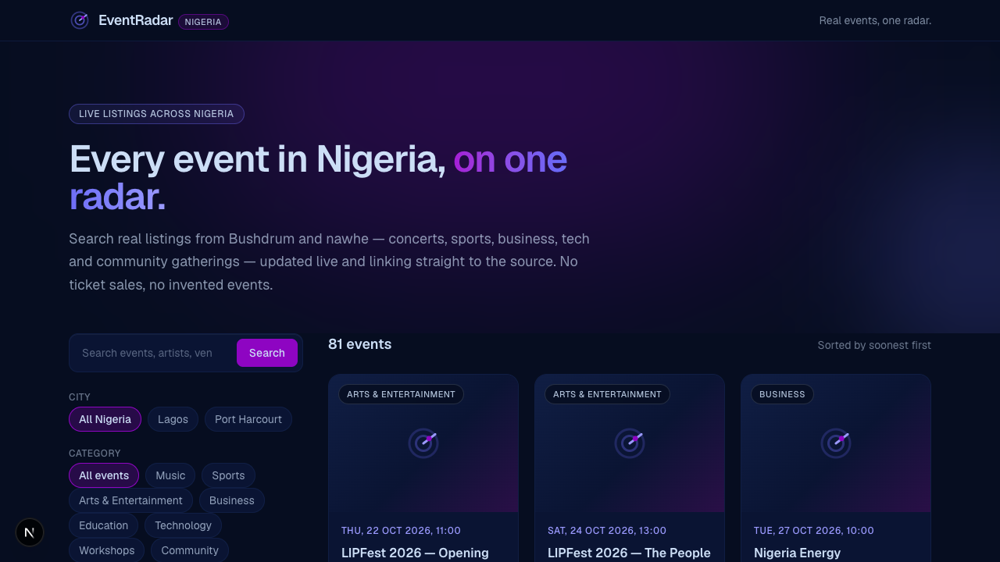

# EventRadar Nigeria

A live event-discovery app for Nigeria: one search box, one feed, real events from
real providers. Every card on screen maps to a verified record from a public
provider API — nothing is seeded, mocked, or inferred.



## What it does

- **Search & filter** — free-text keyword, eight filterable categories (plus an
  honest `other` fallback), and Nigerian city filters, all URL-driven
  (`/?keyword=poetry&city=lagos&category=music`)
  so every view is shareable and works without JavaScript.
- **Honest data** — missing provider fields render as "nothing extra", never as
  guesses. Unknown price? No price pill. No online flag? No online badge.
- **Resilient feed** — one failing provider degrades to partial results (surfaced
  per source) instead of a broken page; total outages produce a friendly error
  state with retry.
- **Fast by construction** — Next.js Partial Prerendering: the shell is static
  HTML, the feed streams in per request; the service layer deduplicates
  concurrent provider round-trips and caches responses for 60 s.

## Tech stack

Next.js 16 (App Router, `cacheComponents` + Partial Prerendering) · React 19 ·
TypeScript · Tailwind CSS v4 · Vitest + Testing Library. Zero database, zero
auth, zero API keys — both providers are public and keyless.

## Getting started

```bash
npm install
npm run dev        # http://localhost:3000
```

Requirements: **Node.js ≥ 20.9** (developed on Node 24). **No environment
variables** — providers are keyless by design (see below).

| Script | Purpose |
| --- | --- |
| `npm run dev` | Dev server (Turbopack) |
| `npm run build` / `npm start` | Production build / serve |
| `npm run lint` | ESLint (zero warnings) |
| `npm run typecheck` | `tsc --noEmit` |
| `npm test` / `npm run test:watch` | Vitest (115 tests, one-off / watch) |

## Architecture

```
app/
  api/events/route.ts     GET /api/events — validation boundary (400/502/503)
  page.tsx                Static hero shell + <Suspense> around the feed
  loading.tsx error.tsx   Route-level streaming & error states
components/
  events-explorer.tsx     Async: parses URL → filters + nested Suspense
  event-results.tsx       Async: fetches service → grid, states, pagination
  event-card.tsx          Normalized event as a card (hybrid image policy)
lib/events/
  provider.ts             EventProvider interface (the extension point)
  providers/bushdrum.ts   Adapter: bushdrum.com REST → normalized model
  providers/nawhe.ts      Adapter: nawhe.com v1 → normalized model
  service.ts              Merge, dedupe, sort, paginate, cache (60 s TTL)
  query.ts types.ts       Validation, canonical model, page-size bounds
  taxonomy.ts             Canonical categories/cities ↔ provider mappings
  normalize.ts            Defensive readers for untyped upstream payloads
```

**Provider adapters** are the backbone: each one owns its verified upstream
contract (documented in its header), maps raw payloads into the single canonical
`EventItem` model, and applies whatever filtering the provider actually supports.
The service layer runs adapters in parallel, deduplicates on source-prefixed ids
(conservative: distinct events are never merged across providers), sorts by start
date, and serves bounded pages. Adding a provider is one file plus one entry in
`EVENT_PROVIDERS`.

### API

`GET /api/events` → `{ events, total, page, size, hasMore, sources }`

| Param | Constraint |
| --- | --- |
| `keyword` | ≤ 100 characters |
| `city` | Canonical id (`lagos`, `port-harcourt`) |
| `category` | Canonical id (`music`, `sports`, `business`, …) |
| `startDate` / `endDate` | `YYYY-MM-DD`, start ≤ end |
| `page` | ≥ 1; deep pagination is bounded at offset 200 |
| `size` | 1–50, default 20 |

Errors are machine-safe codes mapped to HTTP: `400 invalid_query`,
`502 provider_unavailable`, `503 rate_limited`. Responses carry
`Cache-Control: max-age=60, stale-while-revalidate=120`, and `sources` reports
each provider's outcome (`ok` / `error` / `rate-limited`) so clients can show
partial results honestly. Provider stack traces and raw payloads never cross the
route boundary.

## Data-integrity decisions

- **No fabricated events.** A record missing a title, valid start time, or a
  valid absolute event URL is skipped — not patched.
- **Absolute URLs only.** Live payloads have shipped garbage like
  `image_url: "COA"`; non-http(s) values degrade to `null` instead of resolving
  against our own origin.
- **Hybrid image policy.** Known CDN hosts go through the Next.js optimizer
  (`lib/image-hosts.ts` is the single allowlist, shared with `next.config.ts`);
  arbitrary organizer hosts render as a plain lazy `` fetched by the
  browser — the server is never an open proxy, and dead images degrade to the
  card background.
- **Null, don't guess.** `isFree`, prices, `isOnline`, venue/city — rendered only
  when the provider states them.

## Known limitations (by design)

- **`bushdrum` "All Nigeria" is Lagos-scoped.** Its API requires a city slug and
  silently ignores unknown params, so the unfiltered view queries its first
  Nigerian city (Lagos). Other cities are exact when selected.
- **`nawhe` has a small Nigerian inventory**, and its list endpoint exposes no
  server-side category/date filtering — those are applied locally over a
  bounded fetch window, so deep nawhe results are capped.
- **`bushdrum` never reports online-ness** (`isOnline: null`): the API exposes
  venue presence but no explicit flag, and guessing is off-limits.
- **`total` is the pre-dedupe sum** of provider totals; it can slightly exceed
  the number of distinct events you can page through.
- **Deep pagination is bounded** (offset ≤ 200) to keep provider load honest.
- **Deferred providers.** AllEvents and Ticketmaster were evaluated in Phase 1
  and deferred: both require API keys/approval, which conflicts with the
  keyless, verifiable-first scope. The adapter interface makes them a
  localized addition when keys are available.

## Providers & attribution

Event data from [Bushdrum](https://bushdrum.com) and [nawhe](https://nawhe.com).
Bushdrum's fair-use terms require crediting and linking back — handled in the
site footer. Provider names, marks, and event content belong to their owners;
this app only indexes and links to publicly listed events.

## Testing

115 tests across 16 files: provider adapters (contract fixtures + degraded
payloads), query validation, service caching/dedupe/pagination, and
component behaviour (filter composition, states, pagination, hybrid images)
via Testing Library + jsdom. CI-friendly and fully offline — no live network
calls in tests.
